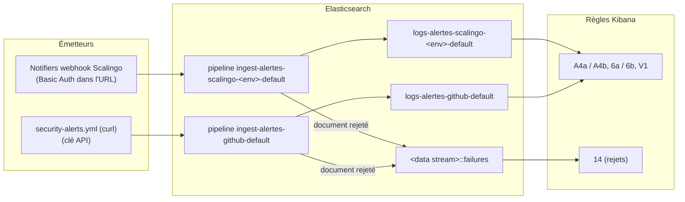

# Collecte par webhook (Scalingo, GitHub)

Les événements émis hors des apps qui arrivent **par webhook** : un appel HTTP
direct de l'émetteur à l'API Elasticsearch, sans agent ni Logstash. Les sources :
les notifiers des apps Scalingo (crash, redémarrage, arrêt, déploiement, seuils
RAM/CPU…) et les CVE remontées par Dependabot via
[`security-alerts.yml`](../../../../.github/workflows/security-alerts.yml).
Ils sont écrits dans un data stream par source, transformés en champs ECS par un
ingest pipeline ([`supervision/pipelines/webhooks/`](../../supervision/pipelines/webhooks/README.md)),
et lus par des Kibana Rules rangées par périmètre :

| Données                                                                       | Alertes                                                                                 |
|-------------------------------------------------------------------------------|-----------------------------------------------------------------------------------------|
| Événements Scalingo des apps applicatives                                     | A4a, A4b dans les [alertes applicatives](../../supervision/alertes-applicatives.md)     |
| Événements Scalingo des apps de la stack (Logstash, Elastic Agent, Heartbeat) | 6a, 6b dans les [alertes de la stack](../../supervision/alertes-stack-observabilite.md) |
| CVE Dependabot                                                                | V1 dans les [alertes de sécurité](../../supervision/alertes-securite.md)                |
| Événements rejetés (failure store)                                            | 14 dans les [alertes de la stack](../../supervision/alertes-stack-observabilite.md)     |

## La chaîne



Un data stream par source, et par environnement pour Scalingo, comme
`logs-<env>-default` : chaque flux a la rétention des logs de son environnement,
et chaque émetteur n'écrit que dans les siens.

Aucun agent à héberger : les émetteurs appellent l'API Elasticsearch, la
transformation en champs ECS se fait dans un **ingest pipeline**.

| Fichier                                                                                                        | Contenu                                                                                                                                                                                                    |
|----------------------------------------------------------------------------------------------------------------|------------------------------------------------------------------------------------------------------------------------------------------------------------------------------------------------------------|
| [`stockage/logs/`](../../stockage/logs/README.md) `2-component-templates.console`, `3-index-templates.console` | mapping et templates des 4 data streams (logsdb, `default_pipeline`, failure store), création à l'avance des data streams ; rétention : les briques `logs-<env>-retention-custom` existantes               |
| [`supervision/pipelines/webhooks/`](../../supervision/pipelines/webhooks/README.md)                            | les ingest pipelines (transformation en champs ECS) et l'accès en écriture des émetteurs ; ce que font les pipelines : [format/webhooks/conventions.md](../../format/webhooks/conventions.md) |
| [`supervision/discovers/webhooks/`](../../supervision/discovers/webhooks/)                                     | sessions Discover des événements, des CVE et des rejets                                                                                                                                                    |

**Un événement = une ligne de notification.** Les règles ne comptent que les
documents arrivés depuis leur exécution précédente (`excludeHitsFromPreviousRun`)
et listent chacun sur une ligne. Elles ne sont **pas** groupées par app : avec
un `groupBy`, Kibana ignore `excludeHitsFromPreviousRun` et renotifie le même
événement à chaque exécution tant qu'il reste dans la fenêtre (constaté en
test). `security-alerts.yml` renvoie à chaque passage toutes les CVE encore
ouvertes : V1 les notifie donc à chaque passage.

## Champs ECS produits

La correspondance champ par champ (payload de la source → champ ECS → règle de
transformation), le gabarit de la ligne `message`, les catégories et émojis, et
les causes de rejet : **[format/webhooks/conventions.md](../../format/webhooks/conventions.md)**.

En résumé : chaque pipeline pose `event.provider` (`scalingo` | `github`),
`event.kind`, `event.action`, `event.id`, `service.name` et `message`, la ligne
de notification de l'événement en texte brut, que les règles et les Workflows
Tchap listent telle quelle. Le payload brut est gardé sous `scalingo.*` ou
`github.*`, lisible dans le document mais **non indexé**.

## Mise en service

À faire dans l'ordre : chaque étape dépend de la précédente.

1. **Stockage** : dans [`stockage/logs/`](../../stockage/logs/README.md), rejouer
   les blocs `logs-alertes*` de `2-component-templates.console`, puis de
   `3-index-templates.console`, **y compris la création des 4 data streams et
   de leur failure store** qui suit les templates : sans elle, les règles
   tombent en erreur tant qu'aucun document n'est arrivé.
2. **Pipelines** : rejouer [`ingest-alertes-scalingo.console`](../../supervision/pipelines/webhooks/ingest-alertes-scalingo.console)
   et [`ingest-alertes-scalingo-format-slack.console`](../../supervision/pipelines/webhooks/ingest-alertes-scalingo-format-slack.console)
   en premier, puis les trois `ingest-alertes-scalingo-<env>-default.console` et
   `ingest-alertes-github-default.console`. Les `_simulate` en fin de fichier
   doivent donner les résultats annoncés en commentaire.
3. **Accès** : rejouer [`acces-webhooks.console`](../../supervision/pipelines/webhooks/acces-webhooks.console)
   en remplaçant `<mot-de-passe-généré>` par un mot de passe alphanumérique,
   rangé dans le coffre de l'équipe. Copier le champ `encoded` de l'API Key.
4. **Sessions Discover** : importer les `.ndjson` de
   [`supervision/discovers/webhooks/`](../../supervision/discovers/webhooks/)
   (cf. [importer](../../supervision/objets-kibana.md#importer)), **avant** les
   règles : leurs liens pointent vers ces sessions par leur id.
5. **Règles** : A4a, A4b ([`2-rules-applicatives.console`](../../supervision/rules/generated/2-rules-applicatives.console)),
   6a, 6b, 14 ([`3-rules-stack-observabilite.console`](../../supervision/rules/generated/3-rules-stack-observabilite.console)),
   V1 ([`1-rules-securite.console`](../../supervision/rules/generated/1-rules-securite.console)).
   Elles reprennent les IDs des anciennes X1 à X5 : `PUT` les met à jour, sauf
   **6b**, nouvelle, à créer avec `POST` (cf. l'en-tête de son bloc).
6. **Test sans Scalingo** :
   ```bash
   printf 'Mot de passe : '; read -rs MDP; echo
   curl -sS -w '\nHTTP %{http_code}\n' -X POST "https://alertes-scalingo:${MDP}@<endpoint-es>/logs-alertes-scalingo-staging-default/_doc" -H 'Content-Type: application/json' -d '{"id":"test","created_at":"'"$(date -u +%FT%TZ)"'","type":"restart","app_id":"test","app_name":"pass-emploi-api-staging","user":{"username":"test"},"type_data":{"scope":["web"],"reason":"user_restart"}}'
   ```
   La réponse doit contenir `"result":"created"` **sans** `"failure_store":"used"`.
   Sous 5 min, A4b le notifie. L'endpoint Elasticsearch est indiqué sur la page
   du déploiement Elastic Cloud (`….es.…`, pas l'adresse de Kibana).
7. **Notifiers Scalingo** : pour chaque app qui a un notifier `Mattermost*`, un
   notifier **Webhook** vers
   `https://alertes-scalingo:<mdp>@<endpoint-es>/logs-alertes-scalingo-<env>-default/_doc`
   (`<env>` = suffixe de l'app), avec **la même sélection d'événements** que le
   notifier `Mattermost*`, et le même nom au préfixe près (`Mattermost
   monitoring production` → `Elastic monitoring production`). Une app qui a deux
   notifiers `Mattermost*` n'a qu'un notifier Elastic, avec l'union de leurs
   événements : deux notifiers écriraient deux fois les événements communs.
   Rattacher aussi les alertes de métriques Scalingo de l'app à ce notifier.
   Commencer par une app non critique (`pass-emploi-logstash-perf`).
8. **GitHub Actions** : [`security-alerts.yml`](../../../../.github/workflows/security-alerts.yml)
   envoie les CVE vers `logs-alertes-github-default` (un `_bulk`, une CVE par
   document, plus `repository`) quand le repo appelant lui passe, tous deux
   optionnels, l'entrée `elastic-url` (sa variable `ELASTIC_URL`, l'endpoint
   Elasticsearch) et le secret `ELASTIC_ALERTES_GITHUB_API_KEY` (champ `encoded`
   de l'API Key de l'étape 3). Sans eux, seul l'envoi Mattermost part, comme
   avant. Repos appelants :
   `pass-emploi-api`, `pass-emploi-web`, `pass-emploi-connect` ; dans chacun,
   créer la variable et le secret puis, dans son `security-alerts.yml`,
   épingler le nouveau commit et les transmettre. Un rejet par Elasticsearch
   fait échouer l'étape, après l'envoi Mattermost.

   **Chaque canal se coupe sans PR**, par une variable du repo appelant
   (*Settings* → *Secrets and variables* → *Actions* → *Variables*), transmise
   en entrée `envoi-mattermost` / `envoi-elasticsearch` :

   | Variable du repo          | Absente (défaut)                                                            | `false`                   |
   |---------------------------|-----------------------------------------------------------------------------|---------------------------|
   | `CVE_ENVOI_MATTERMOST`    | message Mattermost, si le secret `MATTERMOST_WEBHOOK_URL` existe            | pas de message Mattermost |
   | `CVE_ENVOI_ELASTICSEARCH` | CVE envoyées, si `ELASTIC_URL` et `ELASTIC_ALERTES_GITHUB_API_KEY` existent | pas d'envoi               |

   Pendant la migration, V1 poste déjà les CVE dans `#monitoring-production` :
   `CVE_ENVOI_MATTERMOST=false` supprime le doublon de l'envoi direct. Avec les
   deux à `false`, le workflow ne fait que lister les CVE dans son journal.

Pendant la migration vers Tchap, les notifiers `Mattermost*` sont
**désactivés, jamais supprimés**, une fois la parité constatée :
[`verifier-parite.py`](../../supervision/pipelines/webhooks/verifier-parite.py) compare, app par app, l'historique
Scalingo (`scalingo timeline`, limité aux événements sélectionnés dans le
notifier Elastic) aux documents reçus depuis une date, et liste le failure
store. Lecture seule ; code de sortie non nul au moindre écart.

```bash
# ES_URL : l'endpoint Elasticsearch ; ES_API_KEY : une clé API qui peut lire les data streams logs-alertes-*
python3 -I docs/observabilite/supervision/pipelines/webhooks/verifier-parite.py --depuis <date ISO 8601, par exemple 2026-10-19T17:00:00Z>
```

## Limites connues

- **Noms des `type` de crash et de déploiement** : jamais observés sur un
  événement réel, repris du catalogue Scalingo (cf. [table des actions](../../format/webhooks/conventions.md#table-des-actions)).
- **Événements au format Slack** : seules les modifications de variables ont été
  observées. Un autre type dans ce format passe par le même pipeline et sort en
  ℹ️ `scalingo_<libellé>` ; un format encore différent part au failure store
  (règle 14).
- **Identifiants dans l'URL du notifier** : visibles de tous les collaborateurs
  de l'app Scalingo. Acceptable parce que l'utilisateur ne peut qu'ajouter des
  documents aux 3 data streams Scalingo (`create_doc` + `auto_configure`). Pour
  révoquer : changer son mot de passe et mettre à jour les notifiers.
