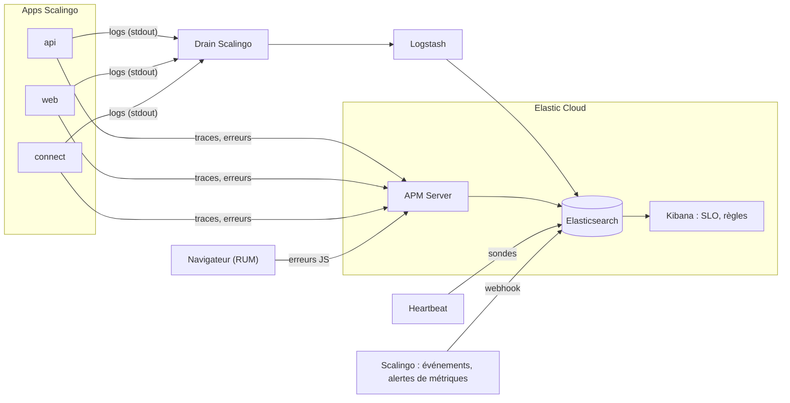
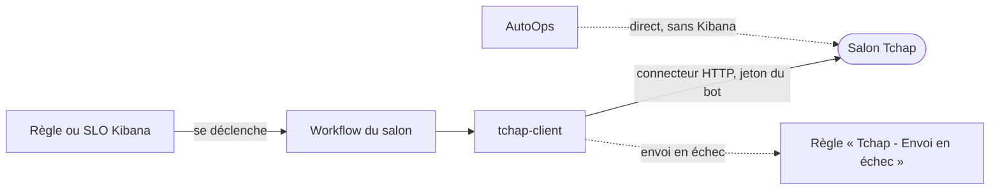

# Fonctionnement — de l'app à Tchap

## La télémétrie

| Signal | Chemin | Sert à |
|---|---|---|
| Logs | stdout → drain Scalingo → Logstash → Elasticsearch | SLO, diagnostic, anomalies |
| Traces et erreurs | agent APM → APM Server | diagnostic, corrélation par `trace.id` |
| Sondes | Heartbeat → Elasticsearch | vu de l'extérieur |
| Événements et métriques Scalingo | notifier webhook → Elasticsearch | événements, 5xx au routeur, charge |

Détail de la chaîne de logs : [collecte des logs](infra/collecte/logs/README.md).

## Le chemin d'une alerte

- Une règle choisit son salon **en choisissant le Workflow de ce salon**.
- **`tchap-client`** est le seul Workflow qui parle à Tchap : il détient le
  jeton du bot.
- **AutoOps** poste directement, pour alerter même quand le cluster est en
  panne.

Décision : [ADR-004](../decisions/ADR-004-notifications-tchap-kibana-workflows.md).
Mode d'emploi des Workflows : [workflows Tchap](../../kibana/workflows/tchap/README.md).
Compte du bot : [runbook d'expiration](runbooks/runbook-tchap-expiration-bot.md).

## Les salons

| Salon | Reçoit |
|---|---|
| `monitoring-production` | promesse, vu de l'extérieur, diagnostic, anomalies, charge, crash d'une app |
| `monitoring-staging` | crash d'une app en staging ou en perf |
| `jobs-production`, `jobs-staging` | jobs en échec, rapport quotidien des jobs |
| `infra-production`, `infra-staging` | opérations d'infra |
| `o11y-production`, `o11y-staging` | la chaîne de télémétrie elle-même |
| `monitoring-securite` | sécurité |

## Le message

1. **Titre**, précédé de l'émoji de sa gravité (🚨, ⚠️, aucun pour ℹ️, ✅ au
   rétablissement), puis l'heure de déclenchement.
2. **Détail** : pour une règle qui liste des résultats, une ligne par résultat.
3. **À vérifier** (cf. [ce que contient une alerte](alertes.md#ce-que-contient-une-alerte)).
4. **Liens**, en fin de message, en URL brute : dashboards, sessions Discover,
   runbook, la règle en dernier.

**Aucun lien HTML** : le pare-feu devant Tchap rejette un message qui en
contient plusieurs, ou qui mêle un lien et une couleur.

Format d'un message et génération : [le message d'une règle](../../kibana/rules/README.md#le-message-dune-règle).
