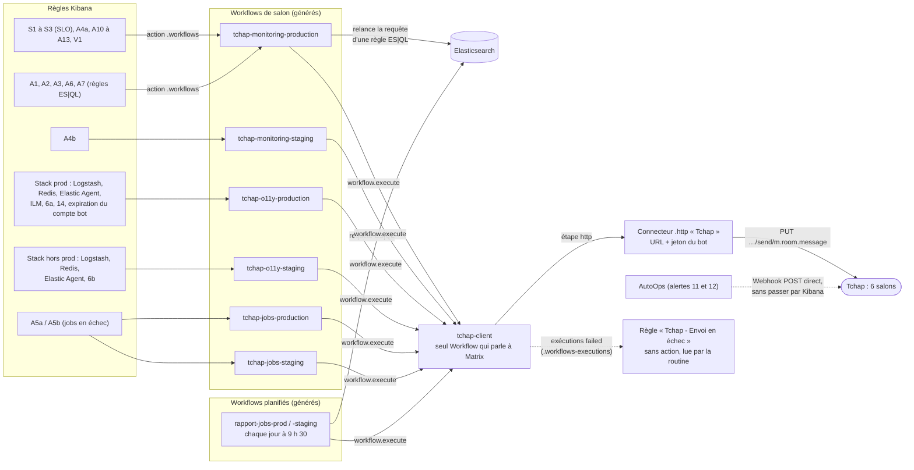

# Notifications Tchap — Workflows Kibana

Les règles Kibana notifient Tchap par des **Workflows** : une règle choisit son
salon en choisissant le Workflow de ce salon dans son action `.workflows`,
comme elle choisissait un connecteur Mattermost par canal. Décision :
[ADR-004](../../../../decisions/ADR-004-notifications-tchap-kibana-workflows.md).



Une règle choisit son salon par le Workflow qu'elle appelle ; les règles ES|QL
passent par leur propre Workflow (cf. [brancher une règle](#brancher-une-règle)).
Tous les chemins aboutissent à `tchap-client`, seul à détenir l'accès à Matrix
(le connecteur et son jeton). AutoOps poste directement : il doit alerter même
cluster en panne.

| Fichier | Contenu |
|---|---|
| [`connecteur-tchap.console`](connecteur-tchap.console) | connecteur `.http` : URL de Tchap et jeton du bot |
| [`tchap-client.console`](tchap-client.console) | le seul Workflow qui parle à Matrix |
| [`tchap-monitoring-production.console`](tchap-monitoring-production.console), [`tchap-monitoring-staging.console`](tchap-monitoring-staging.console), [`tchap-o11y-production.console`](tchap-o11y-production.console), [`tchap-o11y-staging.console`](tchap-o11y-staging.console), [`tchap-jobs-production.console`](tchap-jobs-production.console), [`tchap-jobs-staging.console`](tchap-jobs-staging.console) | un Workflow par salon, **générés** : ne pas les modifier à la main |
| [`rapport-jobs-prod.console`](rapport-jobs-prod.console), [`rapport-jobs-staging.console`](rapport-jobs-staging.console) | rapport quotidien des jobs de l'api, chaque jour à 9 h 30 (heure de Paris), **générés** |
| [`generer-workflows.py`](generer-workflows.py) | génère les Workflows de salon depuis les règles de [`../../rules/`](../../rules/), et les rapports depuis la liste des CRON de `pass-emploi-api` (`origin/develop`) : `python3 -I generer-workflows.py` après toute modification d'une règle, d'un salon ou des CRON de l'api |
| [`../../rules/4-rules-tchap.console`](../../rules/4-rules-tchap.console) | règle « Tchap - Envoi en échec » |
| [`../../rules/5-rules-tchap-expiration-bot.console`](../../rules/5-rules-tchap-expiration-bot.console) | règle « Tchap - Expiration du compte bot », date d'expiration rangée dans Elasticsearch |

## Le message

Le message Tchap d'une règle reprend son **message Mattermost** (titre, couleur,
champs), que `generer-workflows.py` traduit de Mustache en Liquid pour chaque
règle de chaque salon. Ordre :

1. le titre, en couleur (celle du message Mattermost), puis « Déclenchée à » ;
2. les lignes de détail, selon les tags de la règle (cf. [brancher une règle](#brancher-une-règle)) ;
   pour une règle ES|QL, une ligne par résultat de sa requête, que le Workflow de
   salon relance (cf. [brancher une règle](#brancher-une-règle)) ;
3. les explications : « À vérifier », avec le nom des dashboards et des
   sessions en gras ;
4. les liens, en fin de message : Dashboards, Discover sessions, Runbook…,
   « nom - URL brute » (Tchap rend l'URL cliquable), la règle en dernier. Les
   sessions Discover s'ouvrent d'une heure avant le début de l'alerte à 15 min
   après.

**Aucun lien HTML** (`<a>`) : le pare-feu devant Tchap rejette un message à
plusieurs liens, ou à un lien et une couleur (cf. [pièges](#pièges)).

Pour les SLO, la raison anglaise de Kibana (« The burn rate for the past 1h is
18.5… ») est découpée pour écrire la phrase française du message (« Sur 1 h,
… 18,5 fois plus vite que prévu… épuisée en 1,6 jours »).

Le Workflow ne reçoit pas les documents trouvés par la règle (`context.hits`) :
ils sont fusionnés champ par champ dans le document d'alerte, sans lien entre
une app et son action, et `event.action` y est écrasé. D'où une ligne toute
faite par document, dans un seul champ (`message`), et pour les jobs un tableau
`Job | Échecs` suivi des erreurs, sans appariement possible entre les deux.

## Contrat de `tchap-client`

| Entrée | Contenu |
|---|---|
| `salon` | ID du salon, `!…:agent.tchap.gouv.fr` (Tchap → paramètres du salon → Avancé) |
| `texte` | message en texte brut |
| `html` | message en HTML, **déjà échappé** (`\| escape` sur toute donnée) |

Un appel = un message. Le `txnId` de Matrix est l'`execution.id` de l'appel :
il doit changer à chaque message, sinon Matrix croit à une nouvelle tentative
et ne poste rien.

## Mise en service

Référence : la [documentation technique Tchap sur les bots et intégrations](https://aide.tchap.beta.gouv.fr/fr/article/documentation-technique-bot-et-integrations-tchap-1z3dfx/),
et le salon d'entraide [Bots et Intégrations Tchap](https://tchap.gouv.fr/#/room/#BotsetIntgrationsTchapU2tHdMEN80D:agent.dinum.tchap.gouv.fr).

1. **Compte bot** : Tchap n'a pas de compte de service, le bot est un compte
   utilisateur ordinaire, créé à la main dans Tchap web. Email recommandé par
   Tchap : préfixé par `bot-`, ici une **boîte fonctionnelle lue par l'équipe**
   (`bot-pass-emploi@francetravail.fr`, par exemple), parce que le compte doit
   être **renouvelé chaque année** : 11 mois après l'inscription, Tchap envoie
   un lien de renouvellement à cette adresse ; sans clic, le compte expire
   60 jours plus tard et **toutes** les notifications Tchap s'arrêtent.
   Noter la date de renouvellement dans l'agenda de l'équipe.
   **Un seul bot pour tous les salons** : il lit et poste dans tous les salons
   où on l'invite. Adresse `@francetravail.fr` confirmée par l'équipe beta.gouv
   le 2026-10-14 (Julien Bouquillon).
2. **Serveur du bot** : Tchap répartit les comptes sur plusieurs serveurs selon
   le domaine de l'email. Le vérifier avant tout :
   ```bash
   curl -s "https://matrix.agent.tchap.gouv.fr/_matrix/identity/api/v1/info?medium=email&address=bot-pass-emploi@francetravail.fr"
   # {"hs": "agent.tchap.gouv.fr"} → https://matrix.agent.tchap.gouv.fr
   ```
   `francetravail.fr` donne `agent.tchap.gouv.fr`, l'URL utilisée dans cette
   doc. Pour un autre domaine (`beta.gouv.fr` → `agent.dinum.tchap.gouv.fr`),
   remplacer l'URL partout : connecteur, `curl` ci-dessous, connecteurs AutoOps
   des [alertes 11 et 12](../../alertes-stack-observabilite.md#alerte-11--disque-des-nœuds-elasticsearch-autoops).
3. **Salons** : `monitoring-production`, `monitoring-staging`, `o11y-production`,
   `o11y-staging`, `jobs-production` et `jobs-staging` (créés le 2026-10-19),
   **privés et non chiffrés**.
   - **Non chiffrés** : le bot ne sait pas chiffrer. Tchap n'impose pas le
     chiffrement d'un salon de bot (équipe beta.gouv, Julien Bouquillon,
     2026-10-13), les messages respectent les
     [CGU](https://tchap.numerique.gouv.fr/cgu) : pas de donnée sensible ni
     classifiée.
   - **Privés**, sur invitation, pas en forum public : les messages listent nos
     CVE encore ouvertes, nos apps et nos erreurs d'infrastructure, à ne pas
     exposer à tous les agents de Tchap.

   Dans Tchap : **Créer un salon** → **« Salon privé »** (non chiffré,
   accessible uniquement sur invitation), pas « Salon privé sécurisé »
   (chiffré). L'option « Autoriser l'accès à tous les utilisateurs… » ne
   concerne que les salons publics. Le salon peut être créé par un membre de
   l'équipe inscrit sur un autre serveur Tchap (Dinum, par exemple) : les
   serveurs Tchap communiquent entre eux. Y inviter le bot.
4. **Jeton** : se connecter **une seule fois** et réutiliser le jeton.
   Tchap le recommande : se reconnecter à chaque appel crée des dizaines de
   sessions. Puis faire rejoindre au bot chaque salon où il a été invité :
   ```bash
   curl -s -X POST https://matrix.agent.tchap.gouv.fr/_matrix/client/v3/login -H 'Content-Type: application/json' \
     -d '{"type":"m.login.password","identifier":{"type":"m.id.user","user":"bot-pass-emploi-francetravail.fr"},"password":"<mot de passe>","initial_device_display_name":"Kibana alertes"}'
   curl -s -X POST "https://matrix.agent.tchap.gouv.fr/_matrix/client/v3/rooms/<id du salon encodé>/join" -H "Authorization: Bearer <jeton>"
   ```
   La connexion se fait par l'**identifiant Matrix** du bot, pas par son email
   (`m.id.thirdparty` est refusé : « Unsupported login identifier », constaté
   le 2026-10-20). Tchap le dérive de l'email en remplaçant `@` par `-` :
   `bot-pass-emploi-francetravail.fr`, à confirmer dans Tchap après
   l'inscription. La réponse donne le jeton (`access_token`), à ranger dans le
   coffre de l'équipe : il **n'expire pas** (ni `expires_in_ms` ni
   `refresh_token`, constaté le 2026-10-20). Garder aussi `user_id`, à
   reporter dans le document d'expiration (étape 7), et `device_id`, pour
   révoquer la session.
5. **Kibana**, dans Dev Tools : rejouer `connecteur-tchap.console` en
   remplaçant `<jeton-du-bot>`, puis `tchap-client.console`, puis les 4
   `tchap-<salon>.console` tels quels (ils portent l'ID de leur salon).
6. **Test** : poster dans chaque salon depuis Dev Tools.
   ```
   POST kbn:/api/workflows/workflow/tchap-client/run
   { "inputs": { "salon": "<id du salon>", "texte": "test", "html": "<b>test</b>" } }
   ```
7. **Règles** : brancher les règles (ci-dessous), puis rejouer
   [`4-rules-tchap.console`](../../rules/4-rules-tchap.console) et
   [`5-rules-tchap-expiration-bot.console`](../../rules/5-rules-tchap-expiration-bot.console),
   en remplaçant `<identifiant-du-bot>` par le `user_id` de l'étape 4 et
   `<date-expiration>` par la date d'inscription du bot + 11 mois + 60 jours.

**Questions ouvertes**, à poser à l'équipe Tchap dans le salon Bots et
Intégrations (l'équipe beta.gouv n'a pas la réponse, 2026-10-14) :
- la durée de vie du jeton et des sessions inactives. Tchap délègue son
  authentification au Matrix Authentication Service (`auth.agent.tchap.gouv.fr`),
  où elles se règlent côté serveur ; la connexion par mot de passe reste
  acceptée. Un bot qui alerte rarement pourrait voir sa session expirer ;
- l'acceptation durable du `POST …/send/m.room.message` sans `txnId`, dont
  dépendent les alertes AutoOps. À tester soi-même dès que le compte existe,
  dans un salon de test :
  ```bash
  curl -s -X POST "https://matrix.agent.tchap.gouv.fr/_matrix/client/v3/rooms/<id du salon encodé>/send/m.room.message" \
    -H "Authorization: Bearer <jeton>" -H 'Content-Type: application/json' -d '{"msgtype":"m.text","body":"test POST"}'
  ```
  Lancée deux fois, la commande doit renvoyer deux `event_id` différents et
  poster deux messages.

## Brancher une règle

1. Ajouter à la règle le tag `critical` ou `warning` si son titre doit porter
   une gravité (🚨 / ⚠️). Les règles dont chaque ligne porte sa gravité
   (événements Scalingo) n'en ont pas.
2. Ajouter l'action `.workflows` vers le Workflow du salon, celui qui
   correspond au canal Mattermost de la règle :
   ```json
   { "id": "system-connector-.workflows",
     "params": { "subAction": "run", "subActionParams": {
       "workflowId": "tchap-o11y-production", "summaryMode": true,
       "alertStates": { "new": true, "ongoing": false, "recovered": false } } } }
   ```
   - `ongoing: false` pour une règle à seuil (DLQ, 5xx, SLO…) : un message
     quand l'alerte apparaît, aucun tant qu'elle dure. L'action `.workflows`
     **ignore toute fréquence** (`frequency`, throttle, créneau quotidien :
     acceptée par l'API, effacée sans erreur, constaté le 2026-10-19) : les
     relances toutes les 6 h et le bilan de 9 h 30 de Mattermost n'ont pas
     d'équivalent dans Tchap ; l'alerte reste visible dans Kibana.
   - `ongoing: true` pour une règle d'événements (`excludeHitsFromPreviousRun` :
     Scalingo, CVE, jobs) : son alerte ne reste active que si de nouveaux
     événements arrivent, chacun doit être notifié.
   - `recovered: false` : pas de message à la fin de l'alerte. Une alerte qui
     bagote (*flapping*) reste « active », à 0 document, quelques exécutions
     après son rétablissement : le Workflow de salon l'écarte
     (`pending_recovered_count` > 0), sans quoi chaque exécution posterait un
     message vide.
3. Les lignes du message dépendent des tags de la règle :

   | Tag | Lignes | Règles |
   |---|---|---|
   | `tchap-lignes` | le champ `message` des documents, une ligne de notification posée par l'ingest pipeline | A4a, A4b, 6a, 6b, V1 |
   | `jobs` | `❌ <job>` par `labels.job_type`, puis `Erreurs : …` (`error.message`, dédoublonnés : l'appariement job ↔ erreur est perdu dans le document d'alerte) | A5a, A5b |
   | aucun | la raison de l'alerte (`kibana.alert.reason`) | toutes les autres |

   **Ne pas mettre `tchap-lignes`** sur une règle qui lit les logs applicatifs
   (`logs-<env>-default`) : leur `message` est la ligne de log brute, pas une
   ligne de notification (illisible, peut-être personnelle, et au-delà de
   65 Ko l'envoi échoue).
4. **Règle ES|QL** (A1, A2, A3, A6, A7) : `groupBy: all`, une seule alerte
   tant que la requête renvoie des lignes, donc un message à l'apparition (et un
   rappel par heure côté Mattermost). Son action `.workflows` vise le Workflow
   de son salon, comme les autres règles, mais le document d'alerte ne contient
   pas les lignes du résultat. Il contient en revanche les paramètres de la
   règle : l'étape `si-esql` du Workflow de salon relance la requête de la
   règle (`kibana.alert.rule.parameters.esqlQuery.esql`) sur la fenêtre de la
   règle qui précède le début de l'alerte (paramètre `filter` de l'étape, sur
   `@timestamp` : pas sur `NOW()`, quelques secondes plus tard un incident juste
   au-dessus du seuil repasserait dessous). Le message écrit une ligne par
   résultat avec le gabarit `tchap` de la règle (`../../rules/generer-regles.py`) ;
   sans ligne, il le dit (« Sous le seuil à la relecture… »). Le générateur
   refuse une règle ES|QL dont le champ de temps n'est pas `@timestamp` : Kibana
   ne remplace pas une variable dans un nom de champ. Une règle ES|QL en
   `groupBy: row` reçoit, elle, ses colonnes dans `kibana.alert.grouping`.
5. **Règle Uptime** (A10 à A12) : `recovered: true`, et un second message
   Mattermost dans le groupe `recovered` ; le Workflow de salon envoie celui-ci
   pour une alerte rétablie (« ✅ … de nouveau joignable », « Rétablie à »). Les
   variables `{{state.X}}` deviennent `kibana.alert.state.X`. A13 (TLS, une
   exécution par jour) n'a pas de rétablissement mais garde `ongoing: true` :
   un rappel par jour et par certificat, comme dans Mattermost.

**D'où vient le message Tchap** : du body de l'action Mattermost de la règle,
traduit par `generer-workflows.py`. Une règle branchée sur Tchap sans action
Mattermost (« Tchap - Expiration du compte bot ») a son message dans
`MESSAGES_SANS_MATTERMOST`, au même format. Une règle branchée sur Tchap sans
l'un ni l'autre **fait échouer la génération**, en la nommant : elle n'aurait
reçu qu'un message générique (nom de la règle et raison brute de Kibana).

## Ajouter un salon

1. Créer le salon dans Tchap, y inviter le bot, le faire rejoindre (`curl …/join`
   de la mise en service).
2. Copier un `tchap-<salon>.console` en remplaçant le nom du salon partout,
   et son ID (Tchap → paramètres du salon → Avancé) dans `consts.salon`, puis
   l'importer.

## Pièges

- **Pare-feu devant Tchap** (constaté le 2026-10-20) : il rejette certains
  messages par une page HTML 403, sans erreur Matrix, selon un score où des
  éléments anodins s'additionnent : un `=` et un lien ; plusieurs liens HTML
  `<a>` ; un lien `<a>` et une couleur. D'où des messages sans aucun lien
  HTML, des URL brutes, et le `=` remplacé par `＝` dans le texte affiché. Les
  couleurs (`<font data-mx-color>`) et les tableaux HTML passent. Un envoi
  rejeté apparaît en échec dans l'exécution de `tchap-client`
  (`ConnectorExecutionError … [403] Forbidden`) et dans la règle « Tchap -
  Envoi en échec ». Ne pas chercher à contourner ce filtre : simplifier le
  message.

- Une règle ES|QL en `groupBy: row` identifie son alerte par les valeurs de sa
  ligne de résultat : si elles changent (un compteur qui bouge), c'est une
  nouvelle alerte, donc un nouveau message à chaque exécution. D'où
  `groupBy: all` et la relance de la requête par le Workflow de salon.
- Un incident qui oscille autour du seuil d'une règle ES|QL donne un message à
  chaque retour au-dessus, tant que Kibana ne l'a pas vu bagoter (4 changements
  d'état) : 1 ou 2 messages de plus en début d'incident, dans Mattermost comme
  dans Tchap.
- La boucle sur les alertes est une **étape** `type: foreach` ; une propriété
  `foreach:` posée sur `workflow.execute` est ignorée sans erreur.
- Les Workflows exigent la licence **Enterprise**.
- L'action `.workflows` transmet aussi les alertes **en attente de
  rétablissement** d'une règle qui bagote (*flapping*, constaté en test le
  2026-10-19) ; le connecteur Mattermost, non. D'où le filtre `where_exp` du
  `foreach` des Workflows de salon : ne pas le retirer.
- Le compte du bot **expire s'il n'est pas renouvelé** chaque année (lien reçu
  par email 11 mois après l'inscription) : toutes les notifications s'arrêtent.
  La règle « Tchap - Expiration du compte bot » prévient 60 jours avant ;
  procédure : [runbook](../../../runbooks/runbook-tchap-expiration-bot.md).
- Un envoi en échec laisse la règle d'origine à « ok » : seule la règle
  « Tchap - Envoi en échec » le montre. L'erreur Matrix se lit dans l'exécution
  du Workflow (*Workflows → Executions*).
